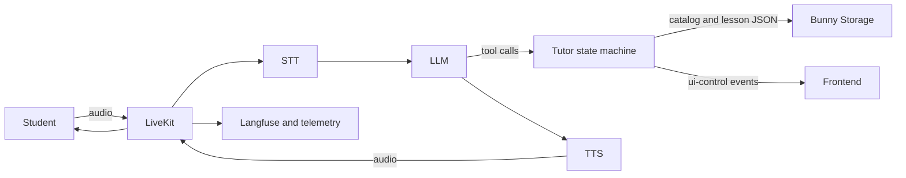

# LiveKit Voice Tutor Architecture

## Overview

The service is a real-time LiveKit voice tutor. It combines a streaming speech pipeline with
English-authored lesson plans stored in Bunny Storage, a lesson/topic progression state machine,
frontend UI events, a semantic teaching board, and Langfuse observability.



The LLM handles natural tutoring and semantic answer evaluation. Application code owns lesson
loading, topic order, completion state, page scrolling, board state, and frontend payloads.

## Repository Layout

Runtime code is under `src/tutor_agent_snd`:

```text
src/tutor_agent_snd/
|-- __init__.py
|-- __main__.py
|-- main.py
|-- domain_types.py
|-- agents/
|   `-- tutor_agent.py
`-- utils/
    |-- agent_observation.py
    |-- bunny.py
    |-- parse_dynamic_prompt.py
    `-- plan_helpers.py
```

Supporting artifacts are organized as follows:

```text
docs/                         implementation and integration documentation
prompts/                      repository prompt artifacts for review/manual deployment
contexts/input/               local source material for offline content generation
contexts/output/              local generated content artifacts
contexts/handoff/             handoff history and the current pipeline integration spec
tests/                        runtime unit tests
```

Important source locations:

| Responsibility | Source |
| --- | --- |
| Worker startup and voice providers | `src/tutor_agent_snd/main.py` |
| Lesson/topic state and model tools | `src/tutor_agent_snd/agents/tutor_agent.py` |
| Runtime dataclasses | `src/tutor_agent_snd/domain_types.py` |
| JSON validation and topic formatting | `src/tutor_agent_snd/utils/plan_helpers.py` |
| Dynamic chapter context | `src/tutor_agent_snd/utils/parse_dynamic_prompt.py` |
| Bunny HTTP access | `src/tutor_agent_snd/utils/bunny.py` |
| Langfuse and usage observation | `src/tutor_agent_snd/utils/agent_observation.py` |

## Runtime Components

### LiveKit Session

`main.py` connects to the room, waits for a participant, reads course context from participant
attributes, builds the dynamic prompt, configures the voice pipeline, starts `AgentSession`, and
registers telemetry and shutdown behavior.

Audio input uses speech-to-text, VAD, dynamic endpointing, adaptive interruption handling, and noise
cancellation. Model output is converted to speech; LiveKit text output is disabled.

### Prompt Assembly

The final agent instructions combine two inputs:

1. The remote `snd-agent-system-prompt` version selected from Langfuse by environment.
2. A dynamic prompt built from participant information, course metadata, chapter metadata, the
   English lesson catalog, and selected output language.

The review artifact at `prompts/snd-agent-system-prompt-v2.md` is not loaded from disk by the
runtime. Deployment is manual: an operator must create and promote the corresponding Langfuse
prompt version. Repository changes do not update Langfuse.

### Bunny Content

The runtime fetches:

```text
courses/{course_id}/01_Course_Knowledge_Schema.md
courses/{course_id}/{chapter_id}/lessons_list.json
courses/{course_id}/{chapter_id}/{lesson_slug}.json
```

`lessons_list.json` provides chapter metadata and the ordered set of allowed lessons. Each lesson
entry has an English `name`, English `brief`, and unique `slug`.

Each lesson JSON contains an exact `LessonPlan` object with ordered topics. Every topic has one
English opaque free-form `content` string, an optional scroll action, and an optional assessment.
There is no rendered chapter prompt or chapter-wide runtime plan.

### Lesson State Machine

`Assistant` owns one active `LessonPlan` and exposes:

| Tool | Responsibility |
| --- | --- |
| `get_lesson_plan` | Validate an approved lesson slug, load its plan, and activate its first topic. |
| `advance_to_next_topic` | Complete and advance from a questionless topic after readiness. |
| `check_topic_understanding` | Process the model's evaluation of an answer to an authored question. |
| `update_teaching_board` | Apply one semantic teaching-board action without changing progress. |

Topic order and prerequisites are validated from the JSON. Successful topic completion publishes a
completion event and activates the next topic. The final topic resolves either the next lesson slug
or chapter completion. A next lesson is loaded separately when the student is ready.

When a topic has a question, the runtime appends a fixed private assessment packet after unchanged
content. A questionless topic receives content only. The application does not parse substructures
from `content`; the model interprets the English facts and teaching guidance.

### Language Behavior

Plans are English regardless of output language. The dynamic prompt selects English or Arabic
student-facing output.

For Arabic output, the system prompt requires Arabic explanation and a bilingual first introduction
for listed technical terms, such as `التزام الأداء (performance obligation)`. Later uses keep only
the English technical term. This policy is model behavior, not a separate JSON schema.

### Frontend Integration

The agent publishes reliable JSON data on LiveKit topic `ui-control`.

Core lesson events:

```text
set_lesson
set_topic
topic_done
scroll
```

Teaching-board events:

```text
board_show
board_hide
board_clear
board_set_title
board_add_bullet
board_add_text
board_add_step
board_emphasize
```

The session watchdog can also publish `session_ending` before shutdown. See
`docs/explanation-plan-execution.md` for exact payloads and ordering.

### Teaching Board

The board is a semantic UI surface, not plan state. It supports one title, up to six short content
items, and exclusive emphasis by opaque generated ID. Showing or hiding preserves content. Clearing
removes content and emphasis while preserving visibility. Loading a new lesson clears board content.

Board guidance can be written into the topic's free-form content. Essential teaching must remain in
voice output; board updates support rather than replace the explanation.

### Observability

`setup_langfuse()` configures tracing using session, user, and environment metadata. LiveKit
telemetry uses the same tracer provider. Session shutdown calculates usage and duration costs,
creates Langfuse scores, and flushes the provider.

No documentation or content-pipeline operation should modify Langfuse. Prompt promotion remains an
explicit deployment action.

## End-To-End Data Flow

1. The worker connects to LiveKit and reads `course_id`, `chapter_id`, `language`, and user metadata.
2. `parse_d_prompt()` fetches course metadata and `lessons_list.json`, validates the ordered lesson
   entries, and returns dynamic instructions plus lesson slugs.
3. `main.py` retrieves the selected system prompt from Langfuse and starts `Assistant` with both
   instruction sources.
4. The student chooses a lesson from the frontend list.
5. `get_lesson_plan` fetches and validates `<lesson_slug>.json`, clears the board, publishes lesson
   state, and activates the first topic.
6. Topic activation publishes topic state, performs an optional page scroll, and returns unchanged
   topic content with optional private assessment context.
7. The LLM teaches in the selected language and optionally updates the teaching board.
8. An assessed topic advances through `check_topic_understanding`; a questionless topic advances
   through `advance_to_next_topic` after readiness.
9. Topic completion updates the frontend and returns the next topic, next lesson slug, or chapter
   completion.
10. TTS streams the spoken response while telemetry records the session.

## Architectural Boundaries

- Bunny JSON is authored content; Python dataclasses are runtime state.
- Free-form topic content is interpreted by the model and is not parsed into runtime fields.
- Progress changes only through the implemented lesson/topic tools.
- Page movement comes only from an exact topic scroll action.
- Board state is managed through semantic board actions and is independent of completion state.
- UI payload names are an external frontend contract.
- The repository prompt file is a review artifact until manually deployed to Langfuse.
- No schema version or legacy content adapter is present.
