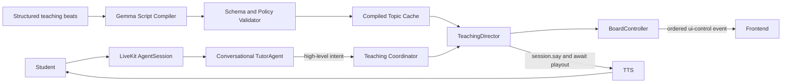
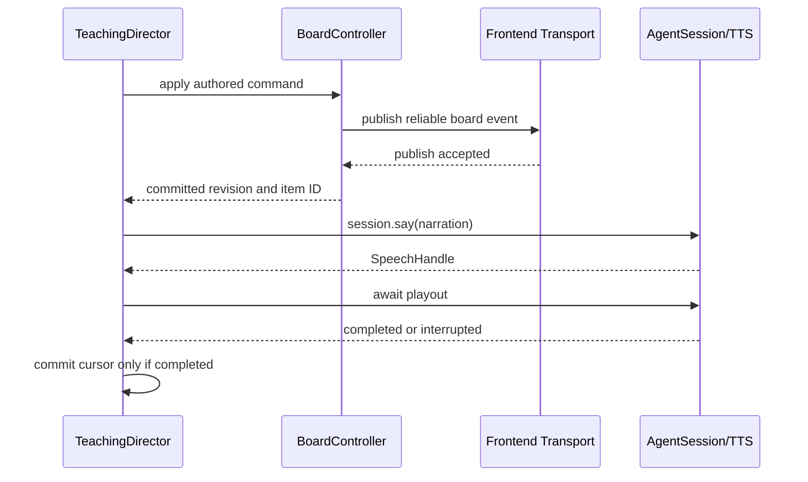

# Board-First Tutor Architecture Implementation Plan

## Purpose

This document is the implementation handoff for restructuring Sanad around the teaching board.
It is intended to be sufficient context for a new engineering chat to begin implementation without
repeating the architecture investigation.

The target is not two simultaneously active voice agents. The target is a separation between:

- Conversational decisions.
- Topic script generation and localization.
- Deterministic board state.
- Deterministic speech and board sequencing.

The architecture must make the board a required part of normal teaching, remove repeated low-level
board function calls from the conversational LLM, preserve interruption handling, and begin the
first board/audio beat within two seconds of lesson selection at p95.

## Confirmed Decisions

These decisions were explicitly confirmed and must not be re-opened unless new evidence makes one
impossible:

| Decision | Selected Direction |
| --- | --- |
| Number of active agents | Choose the best design; two independent LLM agents are not required. |
| Lesson choreography | Hybrid structured beats. Normal lesson structure is authored and validated. |
| Board/speech synchronization | Reliable ordered transport is sufficient initially. Do not wait for a frontend render ACK. |
| Interruption behavior | Pause on the interrupted beat and resume it afterward. |
| Current implementation scope | Backend only. Document complete frontend requirements for later work. |
| Normal narration generation | Generate and localize one complete script per topic, not one LLM call per beat. |
| Persisted content migration | Atomic Bunny lesson schema migration. Do not add a permanent legacy adapter. |
| Script compiler model | Use the current `gemma-4-31b`. |
| Start latency target | Lesson selection to first board item and first audio must be under two seconds at p95. |
| Mid-topic question behavior | Answer visually, then automatically resume the paused authored sequence unless the student asked to stop or switch. |

## Executive Recommendation

Use one active LiveKit conversational agent, one plain sidecar topic script compiler, and a
deterministic teaching runtime.



The key rule is:

> LLMs generate constrained teaching content. Application code owns board mutations, sequencing,
> timing, interruption state, and progression.

Do not give the normal conversational LLM a low-level `update_teaching_board` tool in the target
architecture. The LLM should not decide whether the next board action happens. A validated script
and deterministic director should decide that.

## Repository Baseline

### Runtime Entry Point

`src/tutor_agent_snd/main.py` currently:

- Connects to the LiveKit room and waits for the participant.
- Reads `course_id`, `chapter_id`, language, user name, and user ID attributes.
- Fetches dynamic course/chapter context.
- Configures Deepgram STT, Cerebras LLM, ElevenLabs/Cartesia TTS, Silero VAD, and turn handling.
- Creates one `AgentSession` with `max_tool_steps=16`.
- Fetches `snd-agent-system-prompt` from Langfuse.
- Starts one `Assistant` agent.
- Registers usage observation and shutdown handling.

Relevant code:

- Session/model setup: `src/tutor_agent_snd/main.py:87-148`.
- Langfuse prompt selection: `src/tutor_agent_snd/main.py:155-176`.
- Session start: `src/tutor_agent_snd/main.py:212-230`.
- Tool-step constant: `src/tutor_agent_snd/main.py:29`.

### Current Agent

`src/tutor_agent_snd/agents/tutor_agent.py` currently combines all of these responsibilities:

- Conversational prompt and lifecycle.
- Lesson fetching and activation.
- Topic progression and prerequisite checks.
- Assessment state and retry handling.
- Board visibility, IDs, and emphasis state.
- Frontend event publication.
- Scroll control.
- Four public LLM tools.

Current public tools:

| Tool | Current Responsibility |
| --- | --- |
| `get_lesson_plan` | Fetch, validate, load, and activate a lesson. |
| `advance_to_next_topic` | Advance from a questionless topic. |
| `check_topic_understanding` | Record the conversational model's semantic assessment. |
| `update_teaching_board` | Apply one low-level visual action. |

Current board state is limited to:

- `_board_visible`.
- `_board_title_id`.
- `_board_content_ids`.
- `_board_emphasized_id`.

It does not retain board text, item order, logical authored references, revision, topic/script
correlation, or a full replayable snapshot.

### Current Content Schema

`src/tutor_agent_snd/domain_types.py` defines:

- `LessonPlan`.
- `Topic`.
- `TopicAction`.
- `Question`.

Every `Topic` has one opaque `content: str`. `parse_plan()` in
`src/tutor_agent_snd/utils/plan_helpers.py` validates the outer lesson/topic schema but intentionally
does not parse the content. The conversational LLM interprets all visual beats from prose.

This prevents Python from:

- Validating visual action order.
- Enforcing one narration segment per anchor.
- Saving and resuming a beat cursor.
- Precompiling localized narration.
- Checking emphasis references.
- Knowing whether every required visual beat occurred.

### Current Board Event Contract

The backend publishes reliable JSON on the `ui-control` LiveKit data topic:

```text
board_show
board_hide
board_clear
board_set_title
board_add_bullet
board_add_text
board_add_step
board_emphasize
```

The current board limits are:

- One title.
- At most six non-title items.
- Title length at most 80 characters.
- Content item length at most 180 characters.
- One emphasized item.

### Current SDK Version

The lock file resolves `livekit-agents 1.5.6`. The project declaration is
`livekit-agents[...]~=1.5`.

The first implementation should remain on 1.5.6 unless the compatibility spike identifies a
blocking SDK defect. Do not combine this architecture refactor with an SDK upgrade merely to use
newer features.

LiveKit 1.6 adds per-segment behavior around `FlushSentinel`, and LiveKit Cloud simulations require
1.6.6 or later. Neither feature is required for the target deterministic director.

### Current Tests

The repository has unit coverage for:

- Strict lesson parsing.
- Board action validation and event publication.
- Board IDs and limits.
- Basic interruption checks before a board call.
- Lesson loading and topic progression.
- Assessment success/retry behavior.
- Prompt artifact strings.

It does not currently cover:

- A real `AgentSession` LLM/tool loop.
- Board-to-audio ordering.
- Playout completion before the next visual event.
- Long visual sequences.
- Pause/resume at a beat cursor.
- Frontend render or event acknowledgment.
- Script compiler output.
- Stale background task cancellation.
- Cache/prefetch behavior.

## Root-Cause Analysis

### Tool Execution Races Speech

LiveKit 1.5.6 splits an LLM generation into text and function-call streams. The function execution
task starts while generated text is entering TTS and before playout completes.

Installed SDK references:

- Tool execution starts alongside audio forwarding:
  `.venv/lib/python3.12/site-packages/livekit/agents/voice/agent_activity.py:2544-2577`.
- Audio playout completes later:
  `.venv/lib/python3.12/site-packages/livekit/agents/voice/agent_activity.py:2579-2585`.
- `RunContext.wait_for_playout()` is specifically provided to wait for speech preceding a tool:
  `.venv/lib/python3.12/site-packages/livekit/agents/voice/events.py:81-88`.

`update_teaching_board()` does not call `RunContext.wait_for_playout()`.

The visual-first prompt asks the model to:

1. Call the board tool.
2. Explain that anchor.
3. Call the board tool again.

In practice, the explanation and the next tool call are generated together. The next tool starts
before that generated explanation begins playing. A representative development trace showed:

- A new board item published.
- The following board item published by the next LLM step.
- The speech intended to explain the prior item starting after that second publication.

The board was effectively one visual beat ahead of narration.

### Every Visual Beat Requires Another LLM Request

Every successful low-level board action returns a non-`None` string. LiveKit treats that as requiring
another model response. One substantial topic can therefore require:

- One lesson tool call.
- One title tool call.
- Four to six add calls.
- Several emphasis calls.
- One LLM generation between most calls.

Recent Langfuse prompt-version-9 observations measured approximately:

- 6,020 average input tokens per `llm_request`.
- 944 ms average time to first token per `llm_request`.
- Only a few milliseconds for the board function itself.

The bottleneck is repeated inference over a large prompt and growing tool context, not JSON event
publication.

### `max_tool_steps` Is Not a Teaching Scheduler

`max_tool_steps=16` prevents an unbounded loop. It does not guarantee that:

- Every authored beat executes.
- The correct visual beat precedes speech.
- The LLM uses its remaining calls efficiently.
- A topic is resumable after interruption.

In 1.5.6, the SDK executes a current tool step and then forces the following generation to
`tool_choice="none"` after the limit is reached. Invalid calls and retries still consume steps.

### Prompt Instructions Cannot Provide Deterministic Timing

The current five-to-ten-second cadence is a semantic prompt target. It is not tied to:

- TTS duration.
- Audio playout completion.
- Frontend rendering.
- A stored beat timeline.
- A cancellation token.

Increasing prompt detail further makes each repeated LLM call slower and more expensive without
creating deterministic sequencing.

### Board State Is Not Canonical

The backend cannot reconstruct or replay the full board because it does not store item text and
order. It also lacks:

- A monotonic event revision.
- Script and beat identifiers.
- Lesson/topic execution epoch.
- Idempotency information.
- Snapshot publication.
- Frontend render acknowledgment.

Reliable delivery gives ordered transport. It does not prove that React rendered an event before
audio began. The confirmed initial requirement accepts transport ordering, so no ACK is required in
V2, but the protocol should remain extensible.

### Interruption Can Leave Stale Work

LiveKit interruptions discard the result of an interrupted tool call, but Python tool code can keep
running until it returns. Current progression tools also do not consistently receive `RunContext`.

The target runtime needs an application-level execution epoch and one cancellable director task so
that old work cannot publish after:

- A student interruption.
- A lesson switch.
- Topic progression.
- Session shutdown.
- A newer adaptive explanation.

### Deployment Contracts Are Out of Sync

At analysis time:

- Langfuse development/latest used prompt version 9 with the visual-first tools.
- Langfuse production used prompt version 1 with obsolete `get_explanation_plan` and
  `check_user_understanding` tools and a voice-only architecture.
- The adjacent frontend checkout still consumed old `set_section` and `section_done` events.
- The adjacent frontend checkout did not contain the board reducer/rendering path described by the
  current frontend guide.

Backend, prompt, lesson schema, and frontend protocol must be treated as one release contract even
if frontend implementation occurs later.

## LiveKit Workflow Research

### Handoffs

LiveKit supports one active agent per `AgentSession`. A handoff replaces the active agent. It is
appropriate for distinct, long-lived roles or permission boundaries. It is not appropriate for
switching between a board persona and narration persona every few seconds.

Per-beat handoffs would add:

- Agent transition overhead.
- Explicit context copying or summarization.
- More prompt state.
- More failure modes.
- No simultaneous board/narration execution.

### AgentTask and Supervisor Pattern

`AgentTask` is useful for a focused sub-conversation that temporarily takes control and returns a
typed result, such as consent, intake, or multi-turn data collection.

In installed LiveKit 1.5.6:

- A task may only be awaited from a tool or agent lifecycle hook.
- It pauses the old activity and temporarily becomes the active activity.
- When invoked from a tool, it locks the parent speech handle against interruption until complete.
- It is not a concurrently running background specialist.

Installed SDK reference:

`.venv/lib/python3.12/site-packages/livekit/agents/voice/agent.py:690-939`.

A teaching board update is deterministic state mutation, not a sub-conversation. It belongs in
application code, not an `AgentTask`.

### Alternatives Considered

| Approach | Decision | Reason |
| --- | --- | --- |
| Board agent and narrator agent using handoffs | Reject | Only one is active; per-beat transitions add latency and context complexity. |
| Two independent `AgentSession`s in one room | Reject | Competing STT, TTS, turn state, speech, history, and interruption behavior. |
| One `AgentTask` per visual beat | Reject | Tasks temporarily replace control and are designed for scoped conversations. |
| Board LLM followed by narrator LLM for every beat | Reject | Doubles per-beat inference and still needs deterministic coordination. |
| Custom `llm_node` with streamed control markers | Defer | Generation and TTS can run ahead of playout; markers do not inherently synchronize rendering. |
| LiveKit 1.6 `FlushSentinel` segments | Not needed | Segments improve TTS boundaries but do not replace board state and playout-aware execution. |
| Fully authored final speech in every language | Valid but not selected | Most deterministic, but less flexible than one localized compile per topic. |
| Keep current design and add `wait_for_playout()` | Temporary mitigation | Fixes one ordering race but leaves repeated inference, step limits, and opaque plans. |
| Structured topic script plus deterministic execution | Select | One compile per topic, strict validation, canonical state, and resumable execution. |

## Target Components

### `TutorAgent`

The active `TutorAgent` owns conversation, not board choreography.

Responsibilities:

- Greeting and lesson selection dialogue.
- Student intent classification through normal LLM reasoning.
- High-level routing into lesson teaching, readiness, assessment, or adaptive visual answer.
- Semantic assessment against an authored expected answer.
- Brief administrative, safety, and session responses.
- Supplying the current phase and cursor context to each user turn.

Non-responsibilities:

- Choosing low-level board actions for normal authored teaching.
- Remembering generated board UUIDs.
- Looping through 60 to 120 seconds of low-level tools.
- Deciding when audio playout has completed.
- Mutating topic completion directly outside the coordinator/state machine.

### `TeachingScriptCompiler`

The compiler is a plain sidecar LLM client. It is not an active LiveKit `Agent`, handoff target, or
`AgentTask`.

Responsibilities:

- Receive one structured authored topic outline.
- Receive the selected output language and technical terminology policy.
- Return one strict structured localized topic script.
- Preserve authored beat IDs and order.
- Preserve exact English wording where required.
- Generate short student-facing board text and narration.
- Generate the localized final assessment/readiness question.
- Generate bounded adaptive scripts for mid-topic questions and re-explanations.

The compiler must not:

- Call tools.
- Publish frontend events.
- Speak to the student.
- Choose normal beat order.
- Invent normal board actions.
- Complete topics or assessments.

### `CompiledScriptValidator`

Strict JSON schema conformance is necessary but insufficient. The semantic validator must compare
compiler output against the authored outline.

It owns:

- Beat ID and ordering equality.
- Board/action compatibility.
- Length and word-count checks.
- Exact quotation checks.
- Terminology checks.
- Source-faithfulness checks that can be deterministic.
- Closing question type/count checks.
- Internal-syntax and Markdown rejection.

An optional LLM quality evaluator belongs in tests/evals, not the critical runtime path.

### `TeachingDirector`

The director is the only component that sequences board and speech.

For each beat it must:

1. Verify that the execution epoch is still current.
2. Apply the authored board command through `BoardController`.
3. Await reliable event publication.
4. Start narration through a speech port backed by `session.say()`.
5. Await the returned `SpeechHandle` until playout completes or is interrupted.
6. Commit the cursor only after successful playout.
7. Stop immediately when interrupted or canceled.

The director must never have two active execution loops.

### `BoardController`

The board controller is the canonical backend board model.

It stores:

- Visibility.
- Optional title item.
- Ordered content items.
- Logical authored keys.
- Generated wire IDs.
- Current emphasis key/ID.
- Monotonic revision.
- Current lesson/topic/script identifiers.

It validates every command before publication and commits state only after successful publication.

### `TutorSessionState`

Use typed `AgentSession` userdata for cross-component state.

Suggested fields:

```python
@dataclass
class TutorSessionState:
    lesson_plan: LessonPlan | None
    phase: TutorPhase
    execution_epoch: int
    active_script: CompiledTeachingScript | None
    active_beat_index: int
    interrupted_beat_index: int | None
    board: BoardState
    assessment_attempts: int
    director_task: asyncio.Task[None] | None
```

The exact representation may change, but the state ownership must not move back into prompt-only
behavior.

### Script Cache and Prefetcher

The normal script is independent of individual student identity. Cache using:

```text
course_id
chapter_id
lesson_slug
topic_id
language
lesson_content_hash
lesson_schema_version
compiler_prompt_version
compiler_model
```

Start bounded first-topic prefetch during the greeting/lesson-selection period. Compile the next
topic while the current topic is playing.

## Domain Contracts

### New Lesson Schema Direction

Replace `Topic.content` with structured teaching fields. Use an explicit schema version at the
lesson root so Bunny artifacts and runtime are released atomically.

Illustrative authored topic:

```json
{
  "id": "control-transfer",
  "title": "Control and revenue recognition",
  "sequence": 1,
  "requires_completion_of": null,
  "action": {"type": "scroll", "page": 4},
  "board_reset": true,
  "teaching_beats": [
    {
      "id": "frame-control",
      "board": {
        "action": "set_title",
        "key": "control-title",
        "source_text": "Control triggers revenue recognition",
        "target_key": null
      },
      "narration_intent": "Introduce control as the recognition criterion, not seller activity.",
      "exact_wording_required": false,
      "exact_spoken_text": null
    },
    {
      "id": "exact-rule",
      "board": {
        "action": "add_text",
        "key": "control-rule",
        "source_text": "A company satisfies its performance obligation when the customer obtains control of the good or service.",
        "target_key": null
      },
      "narration_intent": "State the exact rule and identify the customer as the party obtaining control.",
      "exact_wording_required": true,
      "exact_spoken_text": "A company satisfies its performance obligation when the customer obtains control of the good or service."
    },
    {
      "id": "return-to-rule",
      "board": {
        "action": "emphasize",
        "key": null,
        "source_text": null,
        "target_key": "control-rule"
      },
      "narration_intent": "Contrast the recognition rule with delivery evidence.",
      "exact_wording_required": false,
      "exact_spoken_text": null
    }
  ],
  "question": null
}
```

The final exact field names should be selected while writing tests. Preserve these principles:

- Authored data owns action type and order.
- Every add/title action defines one stable logical `key`.
- `emphasize` references a prior logical `target_key`.
- Compiler output never contains or sees wire UUIDs.
- `board_reset` is deterministic topic setup, not an LLM decision.
- Exact wording is represented explicitly, not hidden inside prose instructions.
- Assessment remains authored source data.
- Re-explanation source material remains authored source data.

### Compiled Topic Script

The compiler should return only localized content aligned to the authored beats.

Illustrative strict output:

```json
{
  "topic_id": "control-transfer",
  "language": "Arabic",
  "beats": [
    {
      "id": "frame-control",
      "board_text": "Control هو أساس revenue recognition",
      "narration": "يبدأ revenue recognition عندما يحصل العميل على Control، وليس لمجرد أن البائع نفذ إجراء."
    },
    {
      "id": "exact-rule",
      "board_text": "A company satisfies its performance obligation when the customer obtains control of the good or service.",
      "narration": "A company satisfies its performance obligation when the customer obtains control of the good or service."
    },
    {
      "id": "return-to-rule",
      "board_text": null,
      "narration": "Delivery وlegal title قد يكونان دليلين، لكن المعيار الحقيقي هو انتقال Control."
    }
  ],
  "closing_question": "هل أنت مستعد للانتقال إلى الفكرة التالية؟",
  "closing_question_type": "readiness"
}
```

The Arabic shown above is illustrative data in documentation, not required final wording.

The application merges compiled beat text with the immutable authored action. Never ask the model
to echo the action and then trust its copy.

### Runtime Validation Rules

Reject a lesson or compiled script when any rule fails:

- Lesson schema version is unsupported.
- Beat IDs are empty, duplicated, missing, added, or reordered.
- A board action is unsupported.
- A title/add key is duplicated.
- An emphasis target is missing or references a later beat.
- A topic would exceed six non-title items between resets.
- Title text exceeds 80 characters after trimming.
- Content text exceeds 180 characters after trimming.
- A title/add beat has no board text.
- An emphasize beat unexpectedly has board text.
- Narration is empty.
- Normal narration materially exceeds the 10 to 25 word target without an exact-wording exception.
- Required exact text is changed or omitted.
- Arabic output translates protected technical terms.
- English output unexpectedly switches language.
- Narration contains tool/action names, IDs, JSON, Markdown headings, or internal tags.
- There is not exactly one closing question.
- Closing question type disagrees with the authored assessment/readiness state.
- An assessment reveals its expected answer before the student responds.
- Output introduces unsupported source claims.

Deterministic checks should be strict. Source-faithfulness quality should also be covered by offline
evals because it cannot be fully guaranteed by string validation.

## Runtime Flows

### Startup and Prefetch

1. `entrypoint()` loads chapter metadata and approved lesson slugs.
2. The session starts with `TutorAgent` and typed userdata.
3. During `on_enter()`, the agent greets the student and asks for a lesson choice.
4. In parallel, a bounded prefetcher fetches the first topic of approved lessons and compiles it for
   the selected language.
5. Results enter the content-hash cache only after schema and semantic validation.
6. Prefetch failures are logged and do not crash the voice session.

Prefetch must use bounded concurrency to avoid compiling every lesson at once without limits.
Suggested initial concurrency is two; measure before changing it.

### Selecting a Lesson

1. The conversational model calls a high-level lesson-selection tool.
2. The tool validates the approved slug and loads the strict new plan.
3. The coordinator increments the execution epoch and cancels old teaching work.
4. The coordinator retrieves or awaits the prefetched first-topic script.
5. The board resets according to the topic setup.
6. The director starts the first beat.
7. The tool does not return topic prose to the conversational model.

The implementation must prove how a high-level tool safely schedules the director without creating
an automatic follow-up LLM response. The preferred target is for the tool to return `None` and
schedule the director. Verify this using `AgentSession.run()` in the compatibility spike.

Do not keep a function tool active for the entire 60 to 120 second topic. LiveKit tools are not the
owner of the long-running teaching loop.

### Normal Beat Execution



Reliable publication completion is the selected synchronization boundary. It confirms transport
acceptance, not React rendering. Do not add an arbitrary sleep.

### Questionless Topic

1. Director completes all authored beats.
2. Director speaks the compiled readiness question without another board mutation.
3. Phase becomes `WAITING_FOR_READINESS`.
4. Affirmative readiness invokes a high-level progression tool.
5. The next topic script is retrieved from prefetch/cache and executed.
6. A clarification invokes an adaptive visual answer and then returns to readiness.

### Assessed Topic

1. Director completes all authored beats.
2. Director speaks the localized authored question.
3. Phase becomes `WAITING_FOR_ASSESSMENT`.
4. The latest user answer and expected answer are provided to the conversational agent.
5. The model calls the assessment tool with its semantic judgment.
6. A correct result progresses to the next topic.
7. A first incorrect result compiles a bounded adaptive script from the authored re-explanation
   guide, executes it, and asks the same question again.
8. Maximum retry behavior remains aligned with the existing lesson policy.

### Mid-Topic Question

1. User speech interrupts the current narration.
2. Director stops and retains the current beat as incomplete.
3. Existing board state remains visible.
4. TutorAgent routes the question to a high-level visual-answer operation.
5. Compiler receives only the active topic facts, user question, language, current board snapshot,
   and interrupted beat.
6. Compiler returns a one-to-three-beat adaptive script.
7. Validator rejects unrelated facts, clear/hide actions, invalid refs, and board overflow.
8. Director executes the adaptive script.
9. Director emphasizes the interrupted authored anchor.
10. Director replays the short interrupted narration from its beginning.
11. Director resumes the authored cursor automatically.

Adaptive scripts should prefer `emphasize` of an existing item. Add one corrective item only when
the current board does not contain a suitable anchor and capacity remains.

### Interruption Semantics

Cursor rules:

- Apply the board command before narration.
- Do not mark the beat complete when its board event is published.
- Mark the beat complete only after full speech playout.
- If interrupted, keep the beat index unchanged.
- The already-published anchor is valid and should remain visible.
- Resume by emphasizing that anchor and replaying the short narration.

This can repeat a partially heard sentence, but each beat is intentionally short. This is safer and
simpler than reconstructing word-level partial audio.

### Lesson Switch

1. Increment `execution_epoch` before awaiting network or compiler work.
2. Cancel and await the active director task.
3. Mark existing compiler results stale by epoch/content hash.
4. Load the newly selected approved lesson.
5. Clear board state and publish the reset.
6. Start the new first topic only from a validated script.

### Shutdown

1. Cancel the director and session-scoped prefetch tasks.
2. Await task cleanup with bounded timeout.
3. Prevent new board publication after shutdown starts.
4. Flush traces and usage as today.
5. Do not let shutdown scoring fail because a compiler task was canceled.

## Concurrency and Cancellation Design

### Required Invariants

- Exactly one active director execution task per session.
- Exactly one cursor writer.
- Board revisions increase monotonically.
- Every execution carries the epoch captured when it started.
- A compiler result is accepted only when epoch, content hash, language, and prompt version still
  match.
- A canceled or interrupted execution cannot publish another beat.
- Board state commits only after successful transport publication.
- Cursor state commits only after successful speech playout.

### Suggested Mechanics

Use:

- One `asyncio.Lock` around starting/stopping/replacing director work.
- One monotonically increasing `execution_epoch`.
- One `asyncio.Task[None] | None` for active teaching.
- Separate shared prefetch tasks keyed by immutable cache key.
- `asyncio.CancelledError` propagation; do not swallow cancellation as a generic compiler failure.
- A final epoch check immediately before every board publish.
- A final epoch check immediately after every compiler await.

Do not use sleeps as concurrency control.

### Error Policy

Compiler errors:

- Strict schema failure should normally be impossible with constrained output but still be handled.
- Semantic validation may fail.
- Allow at most one repair request containing concise deterministic validation errors.
- Reject the repaired result if it still fails.
- Do not execute partially valid output.
- Speak one short administrative recovery message and keep the lesson state retryable.

Board publication errors:

- Do not mutate canonical board state.
- Stop the director.
- Log the action, revision attempt, topic, script, and beat without sensitive content.

TTS errors:

- Do not advance the cursor.
- Let the existing TTS fallback adapter operate.
- If all TTS fails, stop and keep the beat resumable.

Cold cache:

- Await the in-flight compiler task rather than starting duplicates.
- Track cold and warm start latency separately.
- Prefetch must make cold lesson selection uncommon.

## High-Level Tool Redesign

Exact names can be finalized with prompt tests, but responsibilities should be approximately:

| Proposed Tool | Responsibility |
| --- | --- |
| `select_lesson(lesson)` | Load a validated lesson and schedule its first topic. |
| `continue_lesson()` | Record readiness and schedule the next questionless topic. |
| `record_assessment(student_understood)` | Record semantic assessment and schedule progression or re-explanation. |
| `answer_topic_question(question_summary)` | Compile and schedule a bounded adaptive visual answer. |

Rules:

- Remove `update_teaching_board` from the target agent's exposed tools.
- Tool bodies validate intent and update high-level state only.
- Board mutations remain internal to `TeachingDirector` and `BoardController`.
- Tools should not directly run an entire long topic before returning.
- Tools that schedule director speech should return `None` so LiveKit does not automatically ask the
  LLM to narrate again.
- Verify tool scheduling and `None` behavior with the installed SDK before relying on it.
- If scheduling directly in the tool races the current speech handle, use the SDK's
  `function_tools_executed` event and `cancel_tool_reply()` as the evaluated alternative.
- Do not implement per-beat handoffs or tasks.

## Script Compiler Design

### Provider/API

Use a separate `cerebras.LLM` instance with:

- Model `gemma-4-31b`.
- Temperature near zero.
- No tools.
- A short timeout appropriate for the two-second start SLO.
- Strict structured output through `response_format`.

The installed Cerebras plugin subclasses the LiveKit OpenAI-compatible plugin, whose `chat()` method
accepts `response_format`. Cerebras documents strict JSON schema output. However, test the exact
Gemma endpoint and generated Pydantic schema before implementation proceeds.

Cerebras structured-output constraints to honor:

- Root schema is an object.
- Every object sets `additionalProperties: false`.
- Keep total schema under 5,000 characters.
- Avoid unsupported regex/string format and array size constraints in provider schema.
- Enforce word/item counts in application validation instead.
- Do not send tools and `response_format` in the same request.

### Prompt Management

Create a separate Langfuse prompt artifact and later a remote prompt named:

```text
snd-teaching-script-compiler
```

The compiler prompt should contain only:

- Role as a constrained localization/narration compiler.
- Output language policy.
- Arabic technical-term policy.
- Source-faithfulness rules.
- Exact-text rules.
- Board text and narration length rules.
- No tool/action/ID/internal syntax rules.
- Instruction to preserve beat IDs/order.

Do not include conversation workflow, tool reference prose, lesson progression, or LiveKit behavior.

The current main visual-first prompt is large because it explains low-level board choreography. The
target conversational prompt should become substantially shorter once choreography moves into code.

### Cache and Prefetch

Initial cache can be process-local and bounded. It must not be an unbounded dictionary.

Required behavior:

- Deduplicate concurrent compilation for the same cache key.
- Do not cache validation failures.
- Invalidate on lesson content hash or compiler prompt version.
- Compile first topics during the greeting.
- Compile the next topic during current-topic playout.
- Record cache hit/miss and compile latency.
- Consider a shared external cache only after process-local behavior is measured.

### Observability

Create spans/attributes for:

- `teaching_script_compile`.
- Compiler prompt name/version.
- Model/provider.
- Course/chapter/lesson/topic identifiers.
- Language.
- Content hash, not full content.
- Cache hit/miss.
- Compile latency and token usage.
- Validation result and failure category.
- Repair attempt count.
- Beat count and total narration word count.

Do not place full user questions, lesson text, or generated narration into metadata attributes.
Normal model input/output tracing may already contain payloads according to existing Langfuse policy.

## Board Protocol V2

### Compatibility Direction

Preserve:

- LiveKit topic `ui-control`.
- Existing `board_*` action names.
- Existing `id` and `text` fields.
- Reliable ordered delivery.

Add optional correlation metadata that an old consumer can ignore.

Example:

```json
{
  "protocol_version": 2,
  "action": "board_add_bullet",
  "session_id": "room-name",
  "lesson_id": "satisfying_performance_obligations",
  "topic_id": "control-transfer",
  "script_id": "script-content-hash",
  "beat_id": "direct-use",
  "revision": 7,
  "id": "board-add-bullet-generated-id",
  "text": "Direct the asset's use"
}
```

### BoardController Semantics

- `board_show` makes the board visible and preserves content.
- `board_hide` hides and preserves content.
- `board_clear` clears title, content, and emphasis while preserving visibility.
- `board_set_title` replaces the title and makes the board visible.
- `board_add_*` appends in event order and makes the board visible.
- `board_emphasize` is exclusive and accepts only a current generated wire ID.
- Add/title actions should not require a separate preceding `board_show` packet.
- A command is validated against canonical state before publication.
- The proposed next state and event are computed together.
- Publication is awaited.
- State commits only after publication succeeds.
- Revision increments once per committed event.

### Snapshot

Define a future-safe `board_snapshot` action containing:

- Visibility.
- Title item or null.
- Ordered content items.
- Emphasized ID or null.
- Current revision.
- Current lesson/topic/script identifiers.

The backend should be able to publish a snapshot at session/lesson reset or on an explicit future
request. The frontend is not required to consume it until its V2 implementation.

### No Render ACK Initially

The chosen synchronization contract is:

1. Await reliable `publish_data()` completion.
2. Start `session.say()` immediately afterward.

Do not add:

- An arbitrary delay.
- A frontend RPC dependency.
- A required `board_rendered` message.

Keep `script_id`, `beat_id`, and `revision` so a future optional ACK can be added without replacing
the event model.

## Frontend Requirements for Later Implementation

Frontend implementation is explicitly out of scope for the current backend refactor. This section
is the complete handoff for later work in:

```text
/home/moaz/dev/work/chapter-14/sanad/web-client-snd
```

### Current Frontend Gaps

At analysis time:

- `src/components/study/session-manager.tsx` uses unguarded `JSON.parse`.
- It handles `set_topic` but still models section events such as `set_section` and `section_done`.
- `src/types/types.ts` has a broad `UIControlData` interface rather than a discriminated protocol.
- No board reducer, canonical client state, or board component was found.

### Required Integration Points

Expected frontend files and responsibilities:

| File | Required Responsibility |
| --- | --- |
| `src/components/study/session-manager.tsx` | Decode, validate, route, and dispatch V2 events. |
| `src/types/types.ts` or a dedicated protocol file | Discriminated event unions. |
| `src/lib/teaching-board.ts` | Runtime guards, initial state, and pure reducer. |
| `src/components/study/teaching-board.tsx` | Accessible board rendering. |
| Study page | Own reducer state and responsive PDF/board layout. |
| Agent launcher | Pass the board dispatcher and reset lifecycle. |

### Event Parsing

- Wrap decoding and `JSON.parse` in `try/catch`.
- Require a non-null object.
- Validate `protocol_version`, `action`, and action-specific fields.
- Ignore malformed or unknown events without crashing the session.
- Preserve existing unrelated UI actions.
- Treat IDs as opaque strings.
- Never infer step order from IDs.

### Reducer State

Suggested state:

```ts
type BoardState = {
  visible: boolean;
  title: BoardItem | null;
  items: BoardItem[];
  emphasizedId: string | null;
  revision: number;
  lessonId: string | null;
  topicId: string | null;
  scriptId: string | null;
};
```

Reducer requirements:

- Ignore duplicate IDs.
- Ignore events with revision less than or equal to the committed revision.
- Apply events in received order.
- Make title/add actions visible.
- Preserve content through hide/show.
- Clear content/emphasis but preserve visibility on clear.
- Replace the existing title on set-title.
- Number only `step` items based on step-item order.
- Enforce six items and current text limits defensively.
- Ignore emphasis of unknown IDs.
- Apply snapshots atomically.
- Reset to exact initial state on disconnect/new session.

Reliable ordered transport means revision gaps should be rare. If a gap occurs, log it and wait for
a later snapshot rather than guessing missing board state.

### Progression Protocol Migration

Frontend logic must use the backend's current progression events:

```text
set_lesson
set_topic
topic_done
scroll
session_ending
```

Remove assumptions that the runtime still sends:

```text
set_section
section_done
number_of_sections
current_section_index
```

`set_topic` must consume the current topic index, authored question, and choices according to the
backend contract.

### Rendering Requirements

- Render semantic DOM, not canvas.
- Desktop visible board: approximately 30 to 35 percent board and remaining PDF width.
- Narrow screens: stack board and PDF without making either unusable.
- Preserve PDF carousel, markers, zoom, scrolling, and controls.
- Use backend IDs as React keys.
- Use `dir="auto"` and logical text alignment.
- Support Arabic, English, and mixed technical terminology.
- Render title, bullets, normal text, and numbered steps distinctly.
- Make explicit emphasis stronger than entry animation.
- Respect `prefers-reduced-motion`.
- Keep agent controls usable while the board is visible.
- Reset between sessions; no persistence is required initially.

### Frontend Tests

- Valid parsing for every event action.
- Malformed JSON does not throw.
- Unknown action is ignored.
- Duplicate and stale revision handling.
- Snapshot replacement.
- Show/hide preservation.
- Clear preservation of visibility.
- Title replacement.
- Ordered item append.
- Exclusive emphasis.
- Unknown emphasis ignored.
- Six-item and text limits.
- Disconnect reset.
- Progression event migration.
- RTL/LTR rendering smoke coverage where supported.

### Acknowledgment Policy

Do not implement a render ACK in the first frontend version. If later measurement proves transport
ordering insufficient, add an optional acknowledgment carrying `script_id`, `beat_id`, and
`revision`. The backend event envelope already provides those identifiers.

## Prompt and Langfuse Strategy

### Conversational Prompt

The target `snd-agent-system-prompt` should focus on:

- Persona and language.
- High-level lesson phases.
- High-level tools.
- Assessment semantics.
- Interruption routing.
- Administrative/safety behavior.
- Requirement to route explanatory questions through visual teaching.

Remove:

- Low-level board action reference.
- Generated board ID rules.
- Per-beat board tool loops.
- `max_tool_steps` workarounds.
- Repeated detailed visual cadence instructions now enforced by the director.

### Compiler Prompt

Add a separate repository artifact and Langfuse prompt for
`snd-teaching-script-compiler`. Compiler prompt and conversational prompt versions must be traced
separately.

### Promotion Rules

- Repository prompt files do not update Langfuse automatically.
- Do not call Langfuse prompt mutation tools during implementation unless the user explicitly asks.
- Use development/latest during implementation.
- Create a new immutable prompt version when ready.
- Promote to production only after the user explicitly requests it and development traces pass.
- Production prompt version 1 is incompatible with the current and target runtime and must not be
  used for the target production deployment.

## Proposed File Layout

Likely new backend package:

```text
src/tutor_agent_snd/teaching/
|-- __init__.py
|-- models.py
|-- board.py
|-- script_compiler.py
`-- director.py
```

Responsibilities:

| File | Change |
| --- | --- |
| `src/tutor_agent_snd/teaching/models.py` | Pydantic authored/compiled contracts and runtime board/script types. |
| `src/tutor_agent_snd/teaching/board.py` | Canonical `BoardController`, event creation, state validation, snapshot. |
| `src/tutor_agent_snd/teaching/script_compiler.py` | Gemma client, prompt assembly, strict response parsing, semantic validation, cache/prefetch. |
| `src/tutor_agent_snd/teaching/director.py` | Deterministic board/speech execution, cursor, interruption, cancellation. |
| `src/tutor_agent_snd/domain_types.py` | Updated lesson/topic state and typed session state where shared. |
| `src/tutor_agent_snd/utils/plan_helpers.py` | Strict schema-version and teaching-beat parsing. Remove opaque content formatter. |
| `src/tutor_agent_snd/agents/tutor_agent.py` | Conversational routing and high-level tools only. |
| `src/tutor_agent_snd/main.py` | Instantiate compiler, cache/coordinator, typed session userdata, and lifecycle cleanup. |
| `src/tutor_agent_snd/utils/agent_observation.py` | Compiler/director metrics and updated pricing/model accounting as needed. |
| `prompts/snd-agent-system-prompt-*.md` | Short target conversational prompt artifact. |
| `prompts/snd-teaching-script-compiler.md` | Separate compiler prompt artifact. |
| `tests/test_teaching_models.py` | Authored and compiled schema contracts. |
| `tests/test_board_controller.py` | Canonical state/revision/event tests. |
| `tests/test_teaching_director.py` | Sequencing, playout, cancellation, interruption, resume. |
| `tests/test_script_compiler.py` | Fake compiler, validation, repair, cache, prefetch. |
| `tests/test_tutor_agent.py` | High-level tool and progression integration. |
| `tests/test_plan_helpers.py` | New atomic lesson schema tests. |
| `docs/frontend-teaching-board-v2-requirements.md` | Extracted frontend-only handoff if desired. |

Do not introduce all abstractions at once without tests. `TeachingDirector` should depend on narrow
board and speech interfaces so most sequencing tests do not require LiveKit.

## Phased Implementation Plan

### Phase 0: Baseline and Compatibility Spike

Tasks:

1. Record the current 75-test baseline and current static-check results.
2. Add an opt-in Gemma structured-output spike using the smallest representative topic schema.
3. Confirm `cerebras.LLM.chat(..., response_format=...)` works with `gemma-4-31b`.
4. Measure full collection latency and schema size.
5. Confirm a high-level LiveKit tool can return `None` and schedule `session.say()` without an
   unwanted follow-up LLM reply.
6. Confirm awaiting a `SpeechHandle` prevents the next synthetic board event.
7. Confirm interruption can stop a scheduled two-beat sequence.

Completion criteria:

- Exact model/schema compatibility proven.
- Scheduling mechanism selected from observed SDK behavior.
- No production behavior changed.

### Phase 1: Tests-First Contracts

Tasks:

1. Add failing tests for authored teaching beats.
2. Add failing tests for compiled scripts.
3. Add schema-version tests.
4. Add logical-key and emphasis-reference tests.
5. Implement the minimum Pydantic/domain models to pass.
6. Keep provider-specific unsupported constraints out of the JSON schema.

Completion criteria:

- Contracts are strict and serializable.
- Every object forbids extra fields.
- Invalid references and board overflow fail deterministically.

### Phase 2: Atomic Content Migration

Tasks:

1. Update `parse_plan()` for the new exact schema.
2. Remove `Topic.content` and `format_topic_content()` usage.
3. Migrate all Bunny lesson artifacts together.
4. Update local ignored/generated lesson examples.
5. Update data model and content-pipeline documentation.
6. Validate every migrated lesson before upload/deployment.

Completion criteria:

- Runtime rejects old opaque content.
- Every persisted lesson parses under the new version.
- No legacy marker/section/content adapter remains.

### Phase 3: Canonical BoardController

Tasks:

1. Implement full board state and logical-key mapping.
2. Implement compute-publish-commit.
3. Add monotonic revisions and V2 metadata.
4. Remove redundant show-before-add publication.
5. Add snapshot generation.
6. Port existing limit/ID tests to the controller.

Completion criteria:

- Board state can be replayed exactly.
- Every event has deterministic state effects.
- Existing action names remain compatible.

### Phase 4: Deterministic TeachingDirector

Tasks:

1. Define narrow `BoardPort` and `SpeechPort` interfaces.
2. Implement serial beat execution.
3. Commit cursor after playout only.
4. Implement epoch checks and cancellation.
5. Implement interruption pause semantics.
6. Implement interrupted-beat re-emphasis/replay.
7. Add shutdown cleanup.

Completion criteria:

- Unit tests prove event-before-speech and playout-before-next-event.
- Unit tests prove no stale beat after cancellation.
- Unit tests prove exact cursor behavior on interruption/resume.

### Phase 5: Compiler, Validation, Cache, and Prefetch

Tasks:

1. Add compiler prompt artifact.
2. Implement strict Gemma request and response parsing.
3. Implement semantic validation.
4. Implement one repair attempt.
5. Implement bounded cache and in-flight deduplication.
6. Prefetch first lesson topics during greeting.
7. Prefetch the next topic during current-topic playout.
8. Instrument compile/cache metrics.

Completion criteria:

- One uncached request produces one full topic script.
- Warm/cached retrieval is immediate.
- Invalid compiler output is never executed.
- Prefetch supports the two-second start SLO.

### Phase 6: TutorAgent Integration

Tasks:

1. Move state into typed session userdata/coordinator.
2. Replace low-level board tool with high-level tools.
3. Stop returning opaque topic prose to the conversational LLM.
4. Schedule first/next topic through the director.
5. Preserve questionless readiness behavior.
6. Preserve authored assessment behavior and retry count.
7. Update prompt contracts and tool schema tests.

Completion criteria:

- Normal topics use zero model-driven low-level board calls.
- Progression behavior remains correct.
- AgentSession integration test confirms no duplicate narration.

### Phase 7: Adaptive Answers and Automatic Resume

Tasks:

1. Add bounded adaptive compiler input/output.
2. Restrict adaptive actions to relevant emphasis/add operations.
3. Route mid-topic questions through adaptive visual teaching.
4. Automatically re-emphasize and resume the authored beat.
5. Handle stop, switch, and unrelated administrative intents.

Completion criteria:

- Topic question is answered visually.
- Paused content resumes exactly once.
- No board clear occurs for routine clarification.

### Phase 8: Prompts, Observability, and Documentation

Tasks:

1. Shorten the conversational prompt artifact.
2. Finalize the compiler prompt artifact.
3. Add prompt-version tracing for both roles.
4. Add director timing and interruption metrics.
5. Add the extracted frontend V2 requirements document.
6. Update architecture/data model/execution docs.
7. Record production prompt migration requirements.

Completion criteria:

- Repository docs match runtime.
- Development traces identify compiler and director behavior.
- No remote prompt is promoted without explicit approval.

### Phase 9: Verification and Rollout

Tasks:

1. Run all unit/static checks.
2. Run opt-in real-provider compiler tests.
3. Run a real development room with English and Arabic.
4. Measure lesson-selection-to-board/audio p50/p95.
5. Test interruption at every beat boundary.
6. Compare token use and tool-call count against current Langfuse baseline.
7. Enable with a development feature flag.
8. Complete frontend V2 before production board rollout.
9. Promote compatible Langfuse prompts only with explicit user approval.

Completion criteria:

- All acceptance criteria below pass.
- Backend, Bunny artifacts, frontend, and prompt versions form one release set.

## Testing Matrix

### Schema and Parser

- Valid versioned lesson parses.
- Old opaque content is rejected after migration.
- Missing/extra keys rejected.
- Beat order and unique IDs enforced.
- Logical key uniqueness enforced.
- Emphasis references only prior/current valid keys.
- Board reset behavior validated.
- Six-item limit validated across full topic action sequence.
- Exact quote fields validated.
- Assessment/readiness shape validated.

### Compiler Unit Tests

- Fake LLM valid response accepted.
- Beat reorder rejected.
- Missing/extra beat rejected.
- Incorrect exact text rejected.
- Excess board text rejected.
- Excess narration rejected.
- Internal syntax rejected.
- Arabic technical-term violation rejected.
- One repair succeeds.
- Second failure returns controlled compiler error.
- Cache hit avoids another request.
- In-flight duplicate awaits one request.
- Content/prompt hash change invalidates cache.

### BoardController

- Title/add implies visible.
- Clear preserves visibility.
- Hide/show preserves content.
- Title replacement invalidates old title wire ID.
- Items preserve order and type.
- Logical keys map to generated wire IDs.
- Emphasis is exclusive.
- Unknown emphasis fails without publication.
- Duplicate/stale command behavior is deterministic.
- Publish failure does not commit state/revision.
- Snapshot exactly matches canonical state.

### TeachingDirector

- Board publish happens before speech starts.
- Next board publish waits for previous playout.
- Cursor commits after playout only.
- Interrupted beat remains current.
- No future board event after interruption.
- Resume emphasizes and replays once.
- Cancellation invalidates old epoch.
- Lesson switch suppresses stale work.
- TTS failure preserves cursor.
- Shutdown cancels and drains safely.

### TutorAgent and Progression

- Exposed tools are high-level only.
- Lesson selection schedules, not narrates, the topic.
- Readiness advances questionless topic only.
- Assessment routes correct/incorrect behavior.
- Re-explanation uses adaptive script.
- Mid-topic question auto-resumes.
- Stop/switch does not auto-resume old content.
- No duplicate agent reply after scheduled director speech.

### LiveKit Integration

Use `AgentSession.run()` with controlled/fake models to verify:

- Correct high-level tool selection.
- Tool returns `None` without another LLM narration.
- Scheduled `session.say` behavior.
- Tool-call history remains valid.
- Interruption/cancellation integration where the framework permits deterministic testing.

LiveKit Cloud simulations are not part of the first implementation because current simulations
require LiveKit Agents 1.6.6 or later and are text-only. Consider them in a later isolated SDK
upgrade.

### Real Provider and Room Checks

- Gemma strict schema compatibility.
- English compilation.
- Arabic compilation with protected technical terms.
- First-topic prefetch latency.
- Cold and warm cache latency.
- Real TTS playout sequencing.
- User interruption during first, middle, and final beat.
- Automatic adaptive answer and resume.
- Event payload inspection against V2 contract.

## Acceptance Criteria and SLOs

The implementation is not complete until all applicable criteria pass:

- Lesson selection to first board event and first audio begins under two seconds at p95.
- Normal uncached topic uses exactly one compiler request.
- Cached topic uses no compiler request.
- Normal teaching uses zero LLM-driven low-level board calls.
- Every explanatory narration has an authored/compiled visual anchor.
- Every board event is published before corresponding speech starts.
- No next board event occurs before prior narration playout finishes.
- Interruption produces no future stale board events.
- Interrupted beat resumes automatically after a visual answer unless the student stops/switches.
- Board title/item/reference limits are enforced before publication.
- Compiler output never reorders authored beats.
- Exact wording is preserved.
- Arabic protected terminology policy is enforced.
- Conversation and compiler prompt versions are independently traceable.
- Average per-topic LLM input tokens are materially lower than the current repeated approximately
  6,020-token requests.
- Production cannot start the target runtime with obsolete prompt version 1.
- All Ruff, MyPy, pytest, Black, and diff checks pass.

Suggested quantitative rollout goals:

- At least 70 percent reduction in LLM input tokens for a normal eight-beat topic.
- Zero compiler semantic validation failures in the release eval dataset.
- Zero duplicate board revisions in integration tests.
- Zero stale publications in repeated interruption stress tests.

## Risks and Mitigations

| Risk | Mitigation |
| --- | --- |
| Gemma strict output differs from documented API | Phase 0 real-provider spike before architecture dependency. |
| Cold compile misses two-second SLO | Greeting-time first-topic prefetch, next-topic prefetch, bounded cache, in-flight deduplication. |
| Compiler produces source-inaccurate narration | Immutable authored actions/facts, semantic validator, one repair, offline eval dataset. |
| Background task speaks after lesson switch | Execution epoch, lock, cancellation, pre-publish stale check. |
| Published anchor has partially heard narration | Do not rollback board; retain beat cursor, re-emphasize, replay short beat. |
| Tool scheduling causes duplicate LLM reply | Return `None`, test `AgentSession.run`, evaluate `function_tools_executed.cancel_tool_reply()` fallback. |
| Frontend is not ready | Backend feature flag, preserve old action names, development-only rollout, complete frontend V2 before production. |
| Production prompt is obsolete | Explicit prompt release checklist and deployment guard/observability. |
| Atomic content migration and runtime deploy diverge | Version lesson schema; deploy Bunny artifacts and runtime together; reject unsupported version. |
| Cache grows without bound | Bounded LRU/TTL behavior and cache metrics. |
| Refactor mixed with SDK upgrade | Keep 1.5.6 initially; upgrade separately after architecture stabilizes. |

## Rollout and Rollback

### Rollout

1. Add a backend feature flag such as `TEACHING_DIRECTOR_V2`.
2. Keep the default off while contracts and tests are built.
3. Run compiler in shadow mode against migrated development content without executing it.
4. Compare validation, latency, and narration quality.
5. Enable deterministic execution in development rooms only.
6. Inspect Langfuse token, latency, interruption, and tool traces.
7. Implement frontend V2 and test full room behavior.
8. Upload all versioned Bunny lessons atomically.
9. Deploy backend and compatible frontend as one release set.
10. Promote compatible Langfuse prompts only after explicit approval.

### Rollback

Because the chosen migration is atomic and has no legacy adapter:

- Roll back backend and Bunny lesson artifacts together.
- Roll back the frontend if it depends on V2-only progression fields.
- Reassign the prior compatible production prompt label only as an explicit deployment action.
- Do not attempt to make a V2 runtime parse old opaque content during an incident.

Preserving existing board action names makes frontend rollback easier, but lesson schema and prompt
versions still need coordinated rollback.

## Temporary Mitigation for the Current Architecture

If the old low-level tool architecture must remain available while V2 is implemented, add this
ordering mitigation at the beginning of `update_teaching_board()` after interruption validation:

```python
await run_context.wait_for_playout()
```

Then check interruption again before publication.

This makes a board tool wait for speech generated before that tool call. It can stop the next visual
anchor from appearing while the previous anchor is still being explained.

This is not the target architecture. It does not fix:

- One LLM request per beat.
- Large repeated prompts.
- Tool-step limits.
- Opaque topic content.
- Missing cursor/snapshot/revision.
- Model-dependent completion of all beats.

Keep this change isolated and covered by a test if implemented.

## Documentation Sources

LiveKit official documentation consulted:

- Workflows: https://docs.livekit.io/agents/logic/workflows/
- Agents and handoffs: https://docs.livekit.io/agents/logic/agents-handoffs/
- Tasks and task groups: https://docs.livekit.io/agents/build/tasks/
- Supervisor pattern: https://docs.livekit.io/agents/logic/supervisor-pattern/
- Function tools and `RunContext.wait_for_playout`: https://docs.livekit.io/agents/logic/tools/definition/
- Agent speech and `SpeechHandle`: https://docs.livekit.io/agents/multimodality/audio/
- Pipeline nodes and hooks: https://docs.livekit.io/agents/logic/nodes/
- Test framework: https://docs.livekit.io/agents/start/testing/test-framework/
- Simulations: https://docs.livekit.io/agents/start/testing/simulations/

Cerebras official documentation consulted:

- Structured outputs: https://inference-docs.cerebras.ai/capabilities/structured-outputs
- Tool calling: https://inference-docs.cerebras.ai/capabilities/tool-use
- Model catalog: https://inference-docs.cerebras.ai/models/overview
- Gemma model: https://inference-docs.cerebras.ai/models/gemma-4-31b

Local SDK sources inspected:

- `livekit/agents/voice/agent_activity.py` for LLM, TTS, and tool sequencing.
- `livekit/agents/voice/events.py` for `RunContext.wait_for_playout()`.
- `livekit/agents/voice/speech_handle.py` for playout and interruption semantics.
- `livekit/agents/voice/agent.py` for `AgentTask` behavior.
- `livekit/agents/voice/agent_session.py` for active agent and speech/session APIs.
- `livekit/plugins/cerebras/llm.py` and `livekit/plugins/openai/llm.py` for structured response support.

## Non-Goals

Do not include these in the first backend implementation:

- Two simultaneous LiveKit voice agents.
- Per-beat agent handoffs.
- Per-beat `AgentTask` delegation.
- Per-beat compiler/narrator LLM calls.
- Word-level board synchronization.
- Required frontend render acknowledgments.
- Freehand drawing, shapes, coordinates, student board editing, or whiteboard libraries.
- Persistent cross-session student board history.
- LiveKit SDK 1.6 upgrade solely for simulations or `FlushSentinel`.
- Permanent compatibility with opaque `Topic.content` after atomic migration.
- Automatic Langfuse prompt promotion.
- Frontend code changes in the current backend implementation chat.

## Next Chat Start Here

The next implementation chat should begin with Phase 0 and Phase 1 only. Do not start by rewriting
`TutorAgent`.

### First Implementation Slice

1. Inspect current status without reverting unrelated work.
2. Run the existing baseline.
3. Add failing tests for authored `TeachingBeat` and compiled script contracts.
4. Add `src/tutor_agent_snd/teaching/models.py` with the minimum strict Pydantic models.
5. Add an opt-in Gemma structured-output integration test or small non-production spike.
6. Verify the generated JSON schema against Cerebras limits.
7. Add a minimal fake `BoardPort`/`SpeechPort` director test proving event-before-speech and
   playout-before-next-event.
8. Stop and review those contracts before migrating persisted lessons.

Commands:

```bash
git status --short --untracked-files=all
uv sync
uv run pytest
uv run ruff check .
uv run mypy .
uv run black --check src tests
git diff --check
```

After the first slice:

```bash
uv run pytest tests/test_teaching_models.py tests/test_teaching_director.py
uv run ruff check .
uv run mypy .
git diff --check
```

### Facts the Next Chat Must Retain

- Frontend work is not in current scope, but its V2 contract must be documented.
- Normal board actions are authored and deterministic.
- Gemma generates/localizes the whole topic once.
- There is one active LiveKit conversational agent.
- Board mutation is internal application code.
- Transport ordering is accepted; no render ACK now.
- Interrupted beat resumes automatically.
- Bunny migration is atomic; do not add a legacy runtime adapter.
- p95 first board/audio target is under two seconds.
- Keep LiveKit 1.5.6 during the initial refactor.
- Do not promote or mutate Langfuse prompts without explicit user approval.

### First Review Gate

Before Phase 2 begins, confirm with tests and a short implementation report that:

- Gemma strict structured output works with the proposed schema.
- Provider schema is below the size limit and uses no unsupported constraints.
- The director interfaces can be tested without a LiveKit room.
- The high-level tool scheduling approach does not create duplicate speech.
- The authored schema can represent every existing title, text, bullet, step, emphasis, exact quote,
  assessment, and recovery requirement.

Only then migrate all lessons and replace the runtime architecture.
