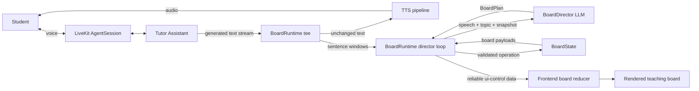
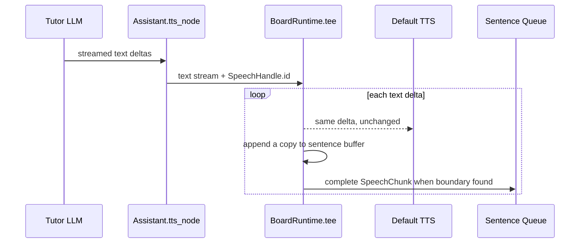

# Current Board Director Architecture

## Document Status

This document describes the board architecture implemented by commit `66bdd41`
(`Add new board agent archetecture`) on August 31, 2026. It documents the code as it
exists after that update, rather than an aspirational future design.

The most important source files are:

| Area | Source |
| --- | --- |
| Session assembly | `src/tutor_agent_snd/main.py` |
| Conversational tutor integration | `src/tutor_agent_snd/agents/tutor_agent.py` |
| Board data contracts | `src/tutor_agent_snd/board/models.py` |
| Authoritative board state | `src/tutor_agent_snd/board/state.py` |
| Board-planning LLM | `src/tutor_agent_snd/board/director.py` |
| Speech feed and operation executor | `src/tutor_agent_snd/board/runtime.py` |
| Board Director prompt artifact | `prompts/snd-board-director-prompt.md` |
| Tutor prompt artifact | `prompts/snd-agent-system-prompt-board-rounds.md` |

The earlier documents `docs/sanad_ai_board_system_overview.md` and
`docs/board-first-agent-architecture-implementation-plan.md` contain useful design
exploration, but they do not exactly describe the shipped implementation. In particular,
the implementation plan proposes precompiled authored teaching beats, a script cache, and
playout-driven cursor management. The current implementation instead uses a reactive Board
Director that observes generated tutor sentences as they enter TTS.

## Executive Summary

Sanad now has two separate LLM responsibilities inside one LiveKit tutoring session:

1. The **Tutor Agent** owns the conversation, pedagogy, lesson progression, assessment,
   and spoken response.
2. The **Board Director** is a non-speaking sidecar LLM that observes what the tutor is
   about to say and proposes a small set of visual board operations.

The Board Director is not a second LiveKit `Agent`, an `AgentTask`, or a handoff target. It
does not listen to the student directly and never becomes the active conversational agent.
It is a plain LLM-backed component called by an asynchronous runtime beside the tutor.

Application code remains in control of execution:

- `BoardDirector` proposes semantic operations.
- `BoardState` validates operations and owns the canonical session-local board model.
- `BoardRuntime` decides when an accepted operation may execute and publishes it.
- `Assistant` owns deterministic topic boundaries and lesson progression.
- The frontend owns visual rendering, layout, and animation.

The central architectural rule is:

> The Tutor decides what to teach and say. The Board Director decides what may be useful
> to show. Deterministic code validates, times, and publishes every board mutation.

## Why the Architecture Changed

### Previous V1 design

Commit `5ca2793` introduced a board-oriented tutor where the speaking `Assistant` exposed
`update_teaching_board` as a public LLM tool. The tutor model had to alternate between
speech and individual board calls such as:

```text
Tutor LLM -> set title tool -> continue generation
Tutor LLM -> add bullet tool -> continue generation
Tutor LLM -> emphasize tool -> continue generation
```

Board visibility, generated IDs, item limits, and emphasis state also lived directly on
`Assistant`.

That approach had several structural problems:

- Every board action consumed another tool step and often another model round.
- Board actions could execute before the corresponding audio reached the student.
- The tutor prompt had to combine conversation policy, curriculum policy, voice style,
  board mechanics, IDs, limits, and timing.
- The model could omit, duplicate, overuse, or incorrectly sequence board calls.
- Pending actions were difficult to invalidate safely after an interruption.
- The tutor's tool budget was being used as a visual scheduler, which it was not designed
  to be.

### Current design

Commit `66bdd41` removes `update_teaching_board` from the tutor entirely. Tutor speech is
observed at the TTS boundary and passed to an independent planning loop. The tutor now has
only three public workflow tools:

| Tool | Responsibility |
| --- | --- |
| `get_lesson_plan` | Load an approved lesson and activate its first topic. |
| `advance_to_next_topic` | Complete a questionless topic and activate the next topic. |
| `check_topic_understanding` | Record assessment judgment and progress or re-explain. |

Because low-level board calls no longer consume tutor tool rounds, `MAX_TOOL_STEPS` is now
`4` instead of `8` in the immediately preceding implementation.

## System Context



There is one `Assistant`, one `BoardRuntime`, one `BoardState`, and one configured
`BoardDirector` per LiveKit job/session. No board state is shared between sessions.

## Component Responsibilities

### `Assistant`: conversational and lesson owner

`Assistant` remains the only active LiveKit conversational agent. It owns:

- the system and dynamic tutor prompts;
- the current `LessonPlan`;
- current-topic progression;
- topic prerequisite checks;
- assessment retry count;
- scroll, lesson, topic, and completion UI events;
- access to the current LiveKit `SpeechHandle`;
- deterministic clear/title operations at topic boundaries.

It does not own:

- board item IDs;
- board content limits;
- dynamic board planning;
- operation timing;
- an LLM-facing board tool.

The integration point is `Assistant.tts_node()`. It wraps generated text with
`BoardRuntime.tee()` before forwarding that same stream to LiveKit's default TTS node.
This means the board subsystem sees exactly the text that is sent for synthesis, not an
STT transcript reconstructed after playback.

### `BoardDirector`: visual planner

`BoardDirector` is a small wrapper around a structured-output LLM. It receives:

- one or two upcoming tutor sentences;
- session language;
- the active topic title;
- up to 1,200 characters of authored topic content;
- a compact snapshot of the current board;
- title and item length limits;
- the number of remaining board content slots.

It returns a `BoardPlan` containing zero to four `BoardOp` values. Returning no operations
is explicitly the normal outcome for transitions, encouragement, questions, examples, or
ideas already represented on the board.

The Director never:

- speaks to the student;
- receives or controls the LiveKit conversation;
- advances lessons or topics;
- publishes directly to the frontend;
- creates board item IDs;
- controls board visibility;
- bypasses `BoardState` validation.

### `BoardState`: canonical board model

`BoardState` is pure, session-local Python logic with no LiveKit, network, queue, or LLM
dependency. It owns:

- whether the board is visible;
- the optional title item;
- ordered non-title content items;
- the currently emphasized item ID;
- generated opaque item IDs;
- text normalization;
- item count and length limits;
- duplicate-content rejection;
- conversion from semantic operations to frontend payloads.

Every dynamic `board_*` payload originates from this class. This ensures that model output
cannot directly manufacture an ID or bypass board invariants.

### `BoardRuntime`: coordination and execution

`BoardRuntime` connects speech, planning, state, and publication. It contains three logical
parts:

1. **Speech feed**: tees text to TTS while splitting a copy into sentences.
2. **Director loop**: sends sentence windows and board context to `BoardDirector`.
3. **Executor loop**: waits for the estimated speech position, checks staleness and
   interruption, applies operations, and publishes resulting payloads.

The runtime deliberately has no LiveKit imports. Instead, `Assistant` injects narrow
callbacks for publication, topic context, and interruption status. This allows runtime
behavior to be unit tested without a room or real session.

### Frontend: rendering owner

The backend publishes semantic commands. The frontend is expected to own:

- board component state mirroring;
- title, bullet, text, and step rendering;
- step numbering;
- responsive layout;
- Arabic, English, and mixed-direction typography;
- entry and emphasis animation;
- board reset on session teardown.

This repository does not contain the frontend implementation, so frontend behavior cannot
be verified from this codebase alone.

## Data Contracts

### Director operation vocabulary

The Director may propose only these actions:

| Action | Required field | Meaning |
| --- | --- | --- |
| `clear` | none | Remove title, content, and emphasis. |
| `set_title` | `text` | Set or replace the single title. |
| `add_bullet` | `text` | Append an unordered key point. |
| `add_text` | `text` | Append a definition, rule, equation, or contrast. |
| `add_step` | `text` | Append one ordered process step. |
| `emphasize` | `target_id` | Make one existing item the exclusive emphasis target. |

`show` and `hide` are intentionally absent from the model vocabulary. Visibility is owned
by code. A title or content insertion automatically emits `board_show` if needed.

### Structured Director response

```json
{
  "operations": [
    {
      "action": "add_bullet",
      "text": "Reliable delivery",
      "target_id": null
    }
  ]
}
```

Pydantic enforces the allowed action names and the four-operation batch limit. Conditional
argument rules, such as requiring `target_id` only for `emphasize`, are enforced when
`BoardState.apply()` runs.

### Internal board snapshot

The Director receives a compact text representation, for example:

```text
board-set-title-<uuid> | title | TCP
board-add-bullet-<uuid> | bullet | Reliable delivery | emphasized
```

An empty board is rendered as `(empty)`. The snapshot includes item IDs so the Director can
refer to an existing item with `emphasize`, while the prompt forbids inventing IDs.

### Internal scheduling records

`SpeechChunk` records:

- `generation_id`;
- complete sentence text;
- the sentence's starting word offset in the current speech.

`PendingOp` records:

- `generation_id`;
- execution `epoch`;
- release word offset;
- the semantic `BoardOp`.

The generation and epoch are internal cancellation data. They are not sent to the frontend.

## Board State Rules

The current hard limits are:

| Rule | Value |
| --- | --- |
| Titles | One, replaceable |
| Maximum title length | 80 characters |
| Maximum content-item length | 180 characters |
| Maximum non-title items | 6 |
| Active emphasis | One item at a time |

Additional behavior:

- Text is trimmed before validation.
- A lowercase initial Latin letter is sentence-cased when appropriate.
- Arabic and conventionally lowercase names such as `pH` and `iPhone` are preserved.
- Exact duplicate normalized content text is rejected.
- IDs are UUID-backed and generated only after validation.
- `set_title` replaces the old title but does not clear content.
- Replacing an emphasized title clears that emphasis state.
- `clear` removes title, content, and emphasis but preserves visibility.
- `show()` and `hide()` are idempotent.
- `emphasize` may target the title or a content item.
- Re-emphasizing the already emphasized ID is rejected.

## End-to-End Runtime Flow

### 1. Session startup

`entrypoint()` in `main.py` performs the following:

1. Connects to the LiveKit room with audio-only subscription.
2. Waits for a participant.
3. Reads participant attributes including course, chapter, language, user name, and user ID.
4. Loads dynamic course/chapter context and approved lesson slugs.
5. Configures the Tutor LLM fallback, STT, TTS fallback, VAD, turn handling, and interruption policy.
6. Initializes Langfuse tracing.
7. Selects the `latest` prompt label outside production and `production` in production.
8. Fetches `snd-agent-system-prompt` and `snd-board-director-prompt` from Langfuse.
9. Constructs a dedicated Cerebras LLM for `BoardDirector`.
10. Constructs `Assistant`, which constructs its `BoardRuntime` and `BoardState`.
11. Registers runtime shutdown and trace-flush callbacks.
12. Registers the speaking-state event used to anchor board timing.
13. Starts the LiveKit session.

When `Assistant.on_enter()` runs, it starts the runtime's two background tasks and generates
the initial greeting.

### 2. Lesson and topic activation

When the student chooses a lesson, the Tutor LLM calls `get_lesson_plan(lesson)`:

1. The call is rejected if its speech handle is already interrupted.
2. The lesson slug is checked against the approved chapter list.
3. The lesson JSON is fetched from Bunny Storage.
4. The plan is parsed and its slug and sequence are validated.
5. The plan becomes `Assistant.current_plan`.
6. A `set_lesson` event is published.
7. The first topic is activated through `_start_topic()`.

Topic activation is a deterministic boundary:

1. The topic progression rules are validated.
2. The topic is marked started and made current.
3. `_reframe_board()` immediately publishes `clear` and then `set_title`.
4. Pending reactive board operations are invalidated before those operations run.
5. A `set_topic` event is published.
6. An authored `scroll` action is published when present.
7. Formatted topic content is returned privately to the Tutor LLM for explanation.

On the first visible topic, the normal board packet sequence is:

```text
board_clear
board_show
board_set_title
```

On later topics the board is already visible, so the normal sequence is:

```text
board_clear
board_set_title
```

### 3. Speech observation

The Tutor LLM generates its spoken explanation. LiveKit passes generated text into
`Assistant.tts_node()`.



The tee does not wait for the Board Director. A Director timeout or failure therefore does
not block or corrupt tutor speech.

### 4. Sentence extraction

The runtime recognizes sentence endings for English and Arabic punctuation:

```text
. ! ? ؟ …
```

It also flushes a run-on buffer after 240 characters to prevent indefinite buffering. At
the end of a normal text stream, any remaining text is emitted as a final sentence.

Each sentence receives the cumulative word offset at which it begins. Word count currently
uses Python's `sentence.split()`, so it is a simple whitespace estimate rather than a
language-aware tokenizer.

### 5. Board planning

The `board_director` task consumes sentence chunks in FIFO order. It builds windows of at
most two available sentences and then:

1. Confirms that the window belongs to the current generation.
2. Captures the current board snapshot.
3. Reads the current topic context from `Assistant`.
4. Calls `BoardDirector.plan()`.
5. Queues each returned operation for later execution.

A batch is spread across the window rather than released all at once. The first operation
is anchored to the first sentence, the second to the second sentence, and additional
operations are anchored to the final sentence in the window.

The Director request has a two-second outer timeout and zero provider retries. Malformed
JSON, an empty provider response, timeout, or provider exception becomes an empty plan.

### 6. Speech-clock pacing

Generated text reaches TTS before the corresponding audio is heard. Publishing all planned
operations immediately would fill the board at the beginning of a long explanation.

The runtime therefore estimates an operation's release time as:

```text
release_time = speech_started_at + word_offset / words_per_second
```

The default rate is `2.4` words per second and can be changed through
`BOARD_WORDS_PER_SECOND`.

The first text delta creates a provisional clock anchor. When LiveKit emits
`agent_state_changed` with `new_state == "speaking"`, `main.py` calls
`BoardRuntime.on_speech_started()` to replace it with an anchor closer to actual playback.

The executor sleeps for no more than 250 ms at a time so it can repeatedly check
interruption and staleness while waiting.

### 7. Validation and publication

When an operation reaches its release time:

1. `BoardState.apply()` validates it.
2. Invalid operations are rejected and counted without another LLM request.
3. Accepted operations mutate the session-local board model.
4. One or more wire payloads are produced.
5. `BoardRuntime` publishes each payload through the injected callback.
6. `Assistant._publish_ui_control()` JSON-encodes the payload and sends reliable LiveKit data.

All UI messages use:

```text
topic: ui-control
reliable: true
encoding: JSON
```

### 8. Interruption and new speech generations

The runtime uses two related invalidation mechanisms:

- **Generation ID** identifies the current LiveKit speech handle where one is available.
- **Epoch** increments whenever pending work must be invalidated.

When a different speech generation begins, the runtime:

1. stores the new generation ID;
2. increments the epoch;
3. drains queued operations;
4. resets timing, word offset, and sentence buffer;
5. drains queued sentence chunks.

While an operation waits, the executor drops it if:

- its generation no longer matches;
- its epoch no longer matches;
- the current speech handle reports `interrupted`.

Already published board items remain visible. The implementation does not roll the board
back to the exact audio prefix the student heard, and it does not persist a resumable board
beat cursor. A later regenerated explanation may cause the Director to propose an item
again if it is not already represented.

### 9. Topic progression

Completing a topic publishes `topic_done`. If another topic exists, `_start_topic()`
immediately activates it, clears and retitles the board, publishes topic metadata, and
performs any authored scroll.

Questionless topics advance only after student readiness through
`advance_to_next_topic()`. Assessed topics advance or re-explain through
`check_topic_understanding()`.

The Board Director does not participate in this state machine. It reacts only to the speech
produced by the Tutor and to the current topic context supplied by `Assistant`.

### 10. Shutdown

At shutdown:

1. `BoardRuntime.aclose()` cancels the director and executor tasks.
2. Both tasks are awaited and cancellation is consumed cleanly.
3. Runtime counters are logged.
4. Langfuse receives a `board_ops_published` session score whose comment contains all board counters.
5. Existing session duration, cost, and trace flushing continue to run.

The backend does not publish a final `board_hide` or `board_clear`. Frontend session teardown
is expected to reset local board state.

## Concurrency Model

There are three concurrent paths relevant to the board:

| Path | Activity |
| --- | --- |
| LiveKit TTS pipeline | Calls `tee()`, forwards text, and emits sentence chunks. |
| `board_director` task | Serially calls the Board Director for sentence windows. |
| `board_executor` task | Serially waits for and publishes planned operations. |

Both internal queues are FIFO and unbounded:

- `_chunk_queue: asyncio.Queue[SpeechChunk]`
- `_op_queue: asyncio.Queue[PendingOp]`

Director calls are serialized, so only one normal Board Director request runs from the
loop at a time. Planned operations are also executed serially. Topic-boundary
`publish_now()` calls run in the progression call path and can overlap with the two
background tasks at `await` boundaries.

## State Ownership

| State | Owner |
| --- | --- |
| Active lesson, topics, completion, current topic index | `Assistant.current_plan` |
| Assessment retry count | `Assistant.checkpoint_answers_counter` |
| Board visibility, title, items, emphasis | `BoardState` |
| Board IDs and limits | `BoardState` |
| Speech generation, epoch, word offsets, pacing clock | `BoardRuntime` |
| Sentence and pending-operation queues | `BoardRuntime` |
| Visual selection policy | `BoardDirector` prompt and model |
| Speech interruption status and speech ID | LiveKit `SpeechHandle` |
| Rendered visual state | Frontend |

This split is important: the Board Director does not truly own board state. It receives a
snapshot and proposes changes. `BoardState` is authoritative, while `BoardRuntime` owns
execution and cancellation.

## Frontend Wire Protocol

### Board actions

```json
{"action": "board_show"}
{"action": "board_hide"}
{"action": "board_clear"}
{"action": "board_set_title", "id": "<opaque-id>", "text": "<text>"}
{"action": "board_add_bullet", "id": "<opaque-id>", "text": "<text>"}
{"action": "board_add_text", "id": "<opaque-id>", "text": "<text>"}
{"action": "board_add_step", "id": "<opaque-id>", "text": "<text>"}
{"action": "board_emphasize", "id": "<existing-opaque-id>"}
```

`board_hide` exists in `BoardState` but is not currently called by production flow. Once
shown, the board normally remains visible until frontend teardown.

### Related progression actions

```json
{
  "action": "set_lesson",
  "lesson": "<lesson-slug>",
  "number_of_topics": 3
}
```

```json
{
  "action": "set_topic",
  "topic": "<topic-title>",
  "current_topic_index": 1,
  "question": "<question-or-empty-string>",
  "choices": []
}
```

```json
{"action": "topic_done", "topic": "<topic-title>"}
{"action": "scroll", "page": 4}
{"action": "session_ending", "message": "Session ending due to time limit."}
```

The current board protocol has no schema version, board revision, generation ID, epoch,
timestamp, acknowledgement ID, or full-state snapshot.

## Prompt Design

### Tutor prompt

The new tutor prompt artifact tells the conversational model that another system operates
the board. The Tutor must not mention the board to the student. Instead, it should make
speech easy to visualize:

- one idea per sentence;
- roughly 10 to 25 words per sentence;
- explicit concept names rather than pronouns;
- separate sentences for parallel facts;
- ordered processes spoken one step at a time;
- definitions, rules, and formulas isolated in their own short sentences;
- no repeated paraphrases of the same idea.

This is an important coupling: board quality depends partly on the structure of Tutor
speech, even though the Tutor no longer calls board tools.

### Board Director prompt

The Director prompt emphasizes restraint and fidelity:

- JSON structured output only;
- zero to four operations;
- empty plans are normal;
- write compressed labels, not transcripts;
- preserve the Tutor's actual vocabulary;
- preserve English technical terms inside Arabic explanations;
- use only upcoming speech and authored topic content;
- never invent IDs or facts;
- prefer `emphasize` over adding a duplicate idea.

### Runtime prompt source

The Markdown prompt files are repository artifacts for review and tests. Runtime does not
read them directly. `main.py` fetches these Langfuse prompt names:

```text
snd-agent-system-prompt
snd-board-director-prompt
```

Development uses the `latest` label and production uses `production`. Therefore, deploying
code alone does not guarantee that the new local prompt content is active. The matching
Langfuse versions must exist under the expected names and labels.

## Configuration

Board-specific runtime settings are:

| Environment variable | Default | Purpose |
| --- | --- | --- |
| `BOARD_DIRECTOR_MODEL` | `gemma-4-31b` | Select the Director's Cerebras model independently from the Tutor. |
| `BOARD_WORDS_PER_SECOND` | `2.4` | Convert sentence word offsets into estimated release times. |

The Director uses temperature `0.2`, disables parallel tool calls, uses a two-second
timeout, and sets provider retries to zero. Unlike the Tutor LLM and TTS, it has no fallback
adapter. A Director outage is intentionally non-fatal: Tutor speech continues without
dynamic board updates.

## Failure Handling

### Director failure

The following all produce an empty plan:

- timeout;
- provider exception;
- malformed JSON;
- Pydantic validation failure;
- empty model response.

`asyncio.CancelledError` is re-raised so shutdown remains correct.

### Invalid operations

Invalid operations are rejected by `BoardState` and are not sent back to the model for
repair. Rejection counters include reasons such as:

- `empty_text`;
- `text_too_long`;
- `item_limit_reached`;
- `duplicate_text`;
- `generated_id_only`;
- `emphasize_unknown_target`;
- `already_emphasized`.

### Publication failure

Publication exceptions are caught and counted as `publish_failed`, so they do not terminate
the runtime. There is currently no retry, acknowledgement, rollback, or state resynchronization.

### Speech safety

Exceptions in board sentence bookkeeping are caught around `_feed()`. This is a deliberate
fail-open policy: board behavior may be lost, but the voice explanation must continue.

## Observability

Each Director call creates a `board_director` telemetry span with:

- model;
- topic title;
- prompt version when available;
- outcome (`ok`, `timeout`, or `error`);
- operation count;
- latency in milliseconds.

`BoardRuntime.stats` records operational counters, including:

- extracted sentences;
- plans and empty plans;
- failed plans;
- stale windows;
- stale or interrupted operations;
- accepted operations;
- publication failures;
- each validation rejection category.

Accepted operations also produce `board_op_published` logs with action, generation ID,
word offset, and estimated speech elapsed time. At session shutdown, Langfuse receives the
`board_ops_published` score and the full counter dictionary in its comment.

## Test Coverage

The architecture has focused unit coverage:

| Test file | Main coverage |
| --- | --- |
| `tests/test_board_state.py` | IDs, limits, visibility, clear, emphasis, duplicates, normalization, snapshots. |
| `tests/test_board_director.py` | Request context, structured output, streaming JSON, timeout, malformed output, provider failure. |
| `tests/test_board_runtime.py` | Unchanged TTS tee, sentence splitting, pacing, stale generations, interruption, rejection, immediate framing. |
| `tests/test_board_rounds_prompt.py` | Tutor/Director prompt contracts and operation vocabulary. |
| `tests/test_tutor_agent.py` | Tool removal, deterministic topic framing, progression, and reliable UI publication. |
| `tests/test_main.py` | Tool-step, Director model, and pacing defaults. |

At the time of this analysis, the complete repository suite passes with `99 passed`.

Important untested areas include:

- a real LiveKit room and `AgentSession` integration;
- real Cerebras structured output;
- actual TTS playout timing;
- real frontend reducer/rendering behavior;
- publication failure and recovery;
- reconnect and board replay;
- an in-flight Director response racing a topic boundary;
- repeated speaking-state clock re-anchoring;
- queue growth under sustained long output.

## Current Limitations and Risks

These are properties of the current implementation, not theoretical concerns from the old
design.

### State changes before publication is confirmed

`BoardState.apply()` mutates backend state before `_send()` publishes the payload. If
publication fails, backend and frontend can diverge. The Director may later see an item in
the backend snapshot that the frontend never received.

### Published metrics may overstate delivery

`_send()` catches publication errors, after which `_apply_and_publish()` still increments
`ops_published`. The metric counts accepted semantic operations, not confirmed frontend
delivery. An operation that emits both `board_show` and content can also be only partially
delivered.

### In-flight stale-plan race

The director loop checks the generation before awaiting the LLM, but it does not capture
and re-check both generation and epoch after the await. If a topic boundary or new speech
generation occurs during a Director request, the returned old plan can be stamped with the
new current epoch and enter the new frame.

### Final executor race

The executor checks generation and epoch in `_await_release()` and then separately calls
`_apply_and_publish()`. A topic boundary can occur between those two operations. There is
no final stale check immediately before state mutation.

### More than one state mutation path

The normal executor and deterministic `publish_now()` path can both mutate state. They run
on one asyncio event loop, but publication awaits allow interleaving. There is no lock or
single-writer queue around mutation plus publication.

### Approximate synchronization

Timing is based on whitespace word counts and a constant words-per-second value. It does
not use TTS word timestamps, audio playout position, pauses, punctuation duration, or
frontend render acknowledgement. Arabic tokenization and variable speaking rates can
shift visual timing.

### Clock may be re-anchored

Every `speaking` state event resets the anchor while word offsets remain cumulative for the
same generation. If one generation pauses and resumes, later operations may be delayed
relative to the original audio timeline.

### Interruption means drop, not resume

Pending operations are dropped on interruption. Already published content remains. There
is no persisted teaching-beat cursor, automatic re-emphasis, exact replay, or rollback.
This differs from the pause/resume behavior proposed in the earlier implementation plan.

### Heuristic sentence splitting

The splitter can break on abbreviations and decimal periods. A long run-on explanation is
cut at 240 characters, potentially in the middle of a word. It is not language-aware.

### Unbounded queues

Both internal queues are unbounded. Serial Director calls can lag behind rapid or very
long text generation. New generations drain queued work, but there is no normal backpressure
or queue-size policy.

### No board recovery protocol

The protocol has no revision, snapshot, client acknowledgement, replay, or reconnect
recovery. Board state is not persisted between sessions.

### `board_hide` is currently unused

Visibility support exists, but production code never hides the board after it first becomes
visible. Shutdown also sends no reset packet.

### Startup depends on remote prompts

Both Tutor and Director prompts are fetched from Langfuse during startup with no local
fallback. Missing or incorrectly labeled prompts prevent normal session construction.

### Director model has no fallback

If its Cerebras model is unavailable, the session remains conversationally usable but the
dynamic board becomes inactive until calls recover.

## Shipped Design Versus Earlier Proposed Design

The current system should not be confused with the precompiled teaching-beat architecture
in `docs/board-first-agent-architecture-implementation-plan.md`.

| Concern | Current shipped system | Earlier proposed system |
| --- | --- | --- |
| Planning input | Upcoming generated Tutor sentences | Structured authored topic beats |
| Planning frequency | One LLM call per one/two sentence window | One compile per topic |
| Speech ownership | Tutor LLM continues normal generation | Compiled topic narration |
| Timing | Estimated word-rate clock | Explicit board-before-speech beat sequencing |
| Progress cursor | None for board operations | Persistent beat cursor |
| Interruption | Drop pending operations | Pause and resume interrupted beat |
| Cache/prefetch | None | Compiled-topic cache and prefetch |
| Lesson schema | Existing opaque `Topic.content` | Migrated structured teaching beats |
| Board revision/snapshot | Not implemented | Proposed protocol V2 |

The shipped architecture is closer to the "reactive Board Director + deterministic
executor" starting point described in `docs/sanad_ai_board_system_overview.md`.

## Practical Mental Model

The easiest way to reason about the system is as two parallel views of one Tutor output:

```text
Tutor-generated text
        |
        +--> TTS --> student hears the explanation
        |
        +--> sentence splitter --> Board Director --> paced BoardRuntime --> frontend
```

The Board Director does not create the teaching turn. It annotates the turn the Tutor has
already generated. The runtime tries to release those annotations when the matching words
are likely to be heard.

At topic boundaries, the reactive path is temporarily overridden by deterministic code:

```text
topic activation --> invalidate pending board work --> clear --> title --> new speech
```

This separation explains most runtime behavior:

- pedagogy and progression remain with the Tutor;
- visual selection is probabilistic but constrained;
- validity and IDs are deterministic;
- timing is asynchronous and approximate;
- stale pending work is usually dropped by generation/epoch checks;
- the voice path remains operational even when the board path fails.

## Recommended Next Engineering Priorities

Based on the current implementation, the highest-value reliability work would be:

1. Capture generation and epoch before each Director request and re-check both immediately
   after the await.
2. Use one serialized command path for both reactive operations and deterministic topic
   framing, with a final stale check immediately before mutation.
3. Compute proposed board state, publish successfully, then commit state, or add an explicit
   recovery snapshot if publish-before-commit is not practical.
4. Add protocol revision and full `board_snapshot` support for reconnect and divergence recovery.
5. Distinguish accepted operations, payload publication attempts, and confirmed publication
   in metrics.
6. Add integration tests around real LiveKit speech IDs, speaking-state events, and TTS timing.
7. Decide explicitly whether the long-term product should remain reactive or move toward
   the authored teaching-beat compiler described in the earlier plan.

These changes would strengthen the current separation of concerns without moving board
tools back into the conversational Tutor.
