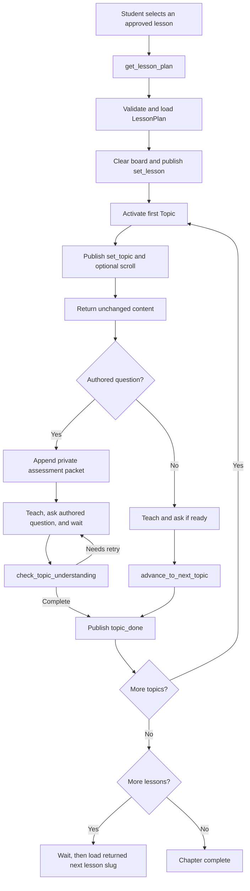

# Lesson Plan Execution

> **Partly superseded (v1).** The progression state machine still holds, but this document predates
> typed segments, the beat cursor, remediation rungs, and `check_topic_understanding`'s
> `chosen_option_id`. It also documents `update_teaching_board`, which no longer exists. See
> [Lesson Plan Structure](board-feature/lesson-plan-structure.md),
> [System Context](board-feature/system-context.md) and
> [Frontend Board Spec v2](board-feature/frontend-board-spec-v2.md).

This document describes the implemented lesson/topic state machine, its model-callable tools, and
the frontend data contract.

Sources of truth:

- `src/tutor_agent_snd/agents/tutor_agent.py`
- `src/tutor_agent_snd/utils/plan_helpers.py`
- `src/tutor_agent_snd/utils/parse_dynamic_prompt.py`

## Execution Overview



The runtime activates the next topic as part of successful topic completion. The progression tool
therefore returns the next topic's content directly; the model must teach that returned content
without making another advancement call.

## Tool API

The `Assistant` exposes exactly four tutoring tools.

### `get_lesson_plan(lesson)`

Loads an approved lesson and activates its first topic.

| Item | Behavior |
| --- | --- |
| Input | Exact lesson slug from the ordered chapter catalog. |
| Storage read | `courses/{course_id}/{chapter_id}/{lesson}.json` |
| Validation | Exact plan schema, matching slug, and matching catalog sequence. |
| State | Replaces `current_plan` only after fetch, JSON parsing, and plan validation succeed. |
| UI | Clears the board, publishes `set_lesson`, publishes first `set_topic`, then performs optional scroll. |
| Return | First topic content, with a private assessment packet only when its question is present. |

Unknown slugs are rejected before storage access. A mismatched plan slug or lesson sequence is also
rejected.

The tool checks interruption state before the fetch, after plan validation, during the board clear,
and before replacing the active plan. It does not retry an interrupted load.

### `advance_to_next_topic()`

Completes a questionless topic when the student is ready.

| Condition | Result |
| --- | --- |
| No active topic | Error; no progress. |
| Active topic has a question | Error directing the model to `check_topic_understanding`. |
| Active topic is already complete | Error; no duplicate completion. |
| Valid questionless topic | Mark complete, publish `topic_done`, and activate or resolve what follows. |

This tool must never be used to bypass an authored question.

### `check_topic_understanding(student_understood)`

Records the model's semantic evaluation of an actual answer to the active authored question.

| Input or state | Result |
| --- | --- |
| No loaded lesson or no active question | Error; no progress. |
| `student_understood=true` | Reset retry count, complete the topic, and activate or resolve what follows. |
| First `false` | Return the authored `reexplain_guide`; remain on the topic and ask again. |
| Second `false` | Complete the topic, return direction to explain the authored expected answer, and include what follows. |

The model, not deterministic application code, decides the boolean by comparing the student's
answer with the expected answer supplied in private context. Clarification requests and normal
follow-up conversation are not answers and should not trigger this tool.

### `update_teaching_board(action, text, item_id)`

Performs one semantic board action. A successful call does not complete a topic and does not end the
teaching turn.

| Action | Arguments | Semantics |
| --- | --- | --- |
| `show` | no `text` or `item_id` | Show the board and preserve content. Repeated show is a no-op. |
| `hide` | no `text` or `item_id` | Hide the board and preserve content. |
| `clear` | no `text` or `item_id` | Remove title, content, and emphasis; preserve visibility. |
| `set_title` | non-empty `text` | Replace the title and return a generated ID. |
| `add_bullet` | non-empty `text` | Append a bullet and return a generated ID. |
| `add_text` | non-empty `text` | Append normal text and return a generated ID. |
| `add_step` | non-empty `text` | Append an ordered step and return a generated ID. |
| `emphasize` | existing generated `item_id` | Emphasize an existing title or content item. |

Title and add actions show the board automatically. Callers cannot supply IDs for newly created
items. Title text is limited to 80 characters, each content item to 180 characters, and a board can
hold at most six non-title content items. A new lesson clears board content before publishing lesson
state.

Board events are skipped when the current tool turn is interrupted. If interruption occurs after an
automatic `board_show` but before the content event, the board can be visible without the new item;
the model must not claim that the item was added.

## Topic Activation

`_start_topic(topic_id)` is an internal helper, not a model-callable tool. It performs these steps:

1. Reset the assessment retry counter.
2. Require an active lesson and resolve the topic ID.
3. Enforce `requires_completion_of` when present.
4. Refuse to leave a started topic with an incomplete question.
5. Mark the target topic started and set `current_topic_index = sequence - 1`.
6. Publish `set_topic` with the title, one-based index, question text, and choices.
7. Publish `scroll` when the topic has an authored scroll action.
8. Return topic content, with the fixed private assessment packet only when needed.

Questionless topics send an empty question string and an empty choices list to the frontend.

## Content And Assessment Delivery

`format_topic_content(topic)` preserves authored content exactly.

| Topic shape | Returned model context |
| --- | --- |
| `question: null` | The unchanged `content` string. |
| Question object | The unchanged `content` string, two newlines, then a fixed private assessment packet. |

The packet contains the authored question, expected answer, choices, and re-explanation guide. Its
control delimiters and labels are private. They are never spoken or displayed as tutoring content.

The runtime does not parse the free-form content string. All factual explanation guidance,
technical-term guidance, and optional teaching-board direction remain ordinary English content for
the model to interpret.

## Completion Behavior

Completing an active topic does this in order:

1. Set `topic.completed = True`.
2. Mark its question complete when present.
3. Publish `topic_done`.
4. If another topic exists, activate it and return its content.
5. If the lesson is complete and another lesson exists, return the next exact lesson slug without
   loading it.
6. If the final lesson is complete, return chapter completion.

The next lesson requires a later `get_lesson_plan` call when the student is ready. The runtime does
not automatically fetch it.

## Frontend Integration

All events below are UTF-8 JSON published reliably on LiveKit topic `ui-control`.

### Lesson And Topic Events

#### `set_lesson`

```json
{
  "action": "set_lesson",
  "lesson": "revenue_recognition_model",
  "number_of_topics": 2
}
```

`lesson` is the lesson slug. `number_of_topics` is the plan's declared and validated topic count.

#### `set_topic`

```json
{
  "action": "set_topic",
  "topic": "Objective of Revenue Recognition",
  "current_topic_index": 1,
  "question": "Why is signing a contract not enough by itself to recognize revenue?",
  "choices": []
}
```

`topic` is the human-readable topic title, not the topic ID. `current_topic_index` is one-based.
For a questionless topic, `question` is `""` and `choices` is `[]`.

#### `topic_done`

```json
{
  "action": "topic_done",
  "topic": "Objective of Revenue Recognition"
}
```

`topic` is the completed topic title.

#### `scroll`

```json
{
  "action": "scroll",
  "page": 6
}
```

The page is always a positive integer validated from the topic action.

### Teaching Board Events

```json
{"action": "board_show"}
{"action": "board_hide"}
{"action": "board_clear"}
{"action": "board_set_title", "id": "board-set-title-...", "text": "Five-Step Model"}
{"action": "board_add_bullet", "id": "board-add-bullet-...", "text": "Identify the contract"}
{"action": "board_add_text", "id": "board-add-text-...", "text": "Revenue follows control."}
{"action": "board_add_step", "id": "board-add-step-...", "text": "Determine the price"}
{"action": "board_emphasize", "id": "board-add-step-..."}
```

IDs are opaque runtime-generated values. The frontend and model must preserve them exactly.

### Session Limit Event

The session watchdog can publish:

```json
{
  "action": "session_ending",
  "message": "Session ending due to time limit."
}
```

It then shuts down the session with draining enabled.

## Error And Ordering Rules

- Only catalog slugs can be loaded.
- Lesson JSON must pass exact-key and value validation before it becomes active.
- Lesson slug and sequence must agree with the catalog.
- Topic prerequisites point backward and must be complete before activation.
- A topic with a pending question cannot be bypassed.
- A questionless topic cannot be completed through assessment.
- An assessed topic cannot be completed through questionless advancement.
- A successful completion publishes `topic_done` once, then returns or activates what follows.
- Tool status text and private assessment data are model control context, not student-facing output.
- There is no section state, section event, schema-version branch, rendered chapter prompt, or legacy
  translation step in this flow.
